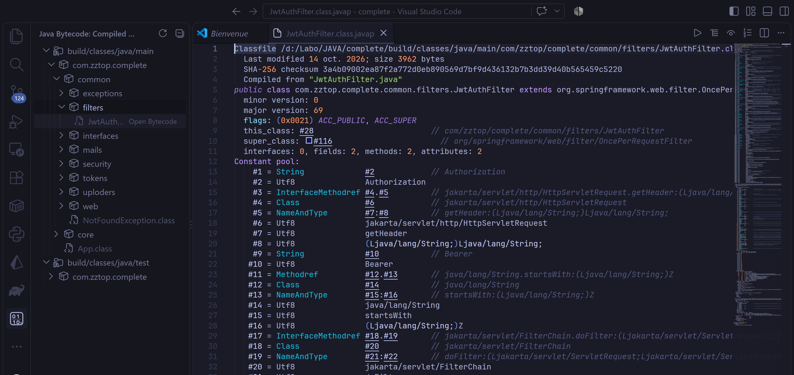

# Java Bytecode Viewer for Visual Studio Code

[](https://github.com/Houssam-OUATMANI/java-bytecode-viewer/releases)
[](https://github.com/Houssam-OUATMANI/java-bytecode-viewer/blob/master/LICENSE)
[](https://code.visualstudio.com)
[](https://github.com/Houssam-OUATMANI/java-bytecode-viewer)

> View and analyze Java compiled bytecode directly inside VS Code



---

## Features

###  1. Activity Bar Bytecode Explorer
* Dedicated activity bar icon with a clean, hierarchical tree view of all compiled `.class` files.
* **Intelligent Package Compacting**: Automatically collapses single-child packages (`com.example.service` instead of 3 deep folders).
* **Inner & Anonymous Classes Nesting**: Nested classes (`Outer$Inner.class`, `Outer$1.class`) are neatly organized under their outer class with child badges.
* **Multi-Module Support**: Seamlessly discovers build directories across multi-module Maven (`target/classes`), Gradle (`build/classes`), and Eclipse/VS Code (`bin`).
* **Instant Hot-Reload**: A built-in file watcher detects re-compilations (`mvn compile`, `./gradlew build`) and updates both the tree and any open bytecode viewer in real time.

###  2. Bi-directional Code $\leftrightarrow$ Bytecode Cursor Sync
* Open any `.java` source file and click the **"Java: Show Bytecode"** button in the editor title bar to open its bytecode side-by-side (*Split View*).
* **Live Cursor Tracking**: As you navigate or click lines in your `.java` file, the bytecode editor automatically scrolls and selects the exact corresponding JVM bytecode instruction!

###  3. One-Click Toolbar Toggles
No need to dig into configuration files to switch views. Three interactive toggles sit directly in the bytecode editor title bar:
* **Toggle Verbose (Constant Pool)** (`$(list-tree)`) : Instantly hide or show the constant pool table and stack map frames to focus purely on method instructions.
* **Toggle Private Members** (`$(eye)`) : Toggle visibility of private methods and fields (`-p`).
* **Toggle Line Number Tables** (`$(list-ordered)`) : Toggle `LineNumberTable` and `LocalVariableTable` debug blocks (`-l`).

###  4. Document Outline & Breadcrumbs Navigation
* Full integration with VS Code's **Outline** panel and **Breadcrumbs**.
* Instantly jump between:
  * The `Constant Pool` table
  * Constructors (`<init>`)
  * Methods (`main`, getters, business logic)
  * Fields and constants

###  5. Interactive Constant Pool Hyperlinks
* Every `#index` reference in the bytecode or constant pool (e.g. `invokevirtual #15 // Method ...`) is rendered as an interactive hyperlink.
* `Ctrl + Click` (or click) on `#15` to jump straight to its declaration line in the Constant Pool!

###  6. Zero-Config & Lightning Fast
* **Auto-detects JDK**: Scans `JAVA_HOME`, `PATH`, and standard installation paths on Windows, macOS, and Linux (JDK 8 up to Java 25+).
* **Smart Memory Cache**: Avoids re-invoking JVM processes on tab switches by caching disassemblies with file modification timestamps (`mtime`).

---

##  Configuration

Customize the extension behavior via your VS Code Settings (`Ctrl+,` / `Cmd+,` and search for `Java Bytecode`):

| Setting | Default | Description |
| :--- | :--- | :--- |
| `javaBytecode.javapPath` | `""` | Custom path to the `javap` executable. If empty, auto-detection is used. |
| `javaBytecode.verbose` | `true` | Print additional information like the Constant Pool and stack map frames (`-v`). |
| `javaBytecode.showPrivateMembers` | `true` | Show all classes and members including private ones (`-p`). |
| `javaBytecode.showLineAndLocalVariableTables` | `true` | Show line number and local variable debug tables (`-l`). |
| `javaBytecode.autoSyncCursor` | `true` | Automatically highlight matching bytecode instructions when moving the cursor in a `.java` file. |
| `javaBytecode.outputDirectories` | `[...]` | Glob patterns for compiled class output directories (Maven, Gradle, etc.). |

---

##  Commands

| Command | Title | Context |
| :--- | :--- | :--- |
| `javaBytecode.showCurrentFileBytecode` | **Java: Show Bytecode** | Editor title bar when editing a `.java` file |
| `javaBytecode.refreshTree` | **Refresh Classes** | View header in the Java Bytecode Explorer |
| `javaBytecode.toggleVerbose` | **Toggle Verbose (Constant Pool)** | Editor title bar when viewing bytecode |
| `javaBytecode.togglePrivateMembers` | **Toggle Private Members** | Editor title bar when viewing bytecode |
| `javaBytecode.toggleLineNumbers` | **Toggle Line Number Tables** | Editor title bar when viewing bytecode |

---

##  Building & Contributing

The extension is bundled with [Bun](https://bun.sh) and [esbuild](https://esbuild.github.io) for near-instant builds (< 50ms):

```bash
# 1. Install dependencies
bun install

# 2. Build extension
bun run build

# 3. Watch mode during development
bun run watch

# 4. Package VSIX for distribution
bunx vsce package
```

Press **F5** in VS Code to launch the Extension Development Host and test your changes.

---

##  License

This project is licensed under the MIT License.
